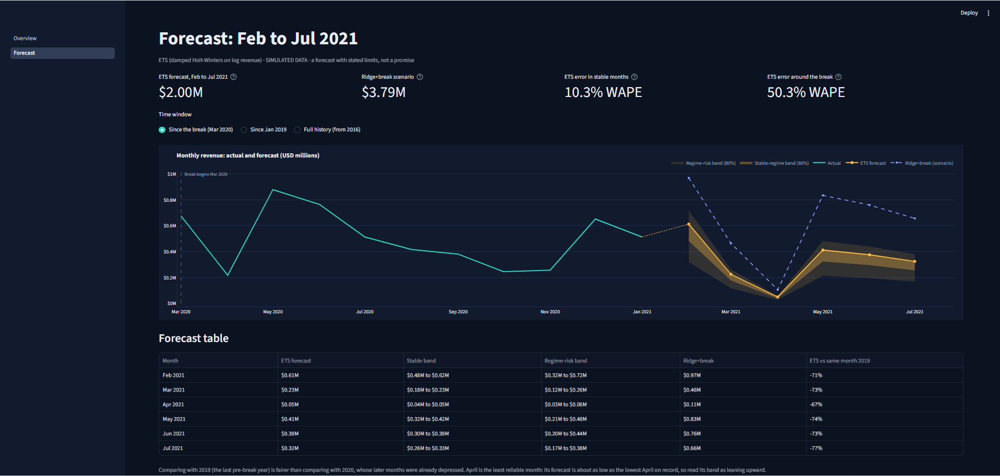
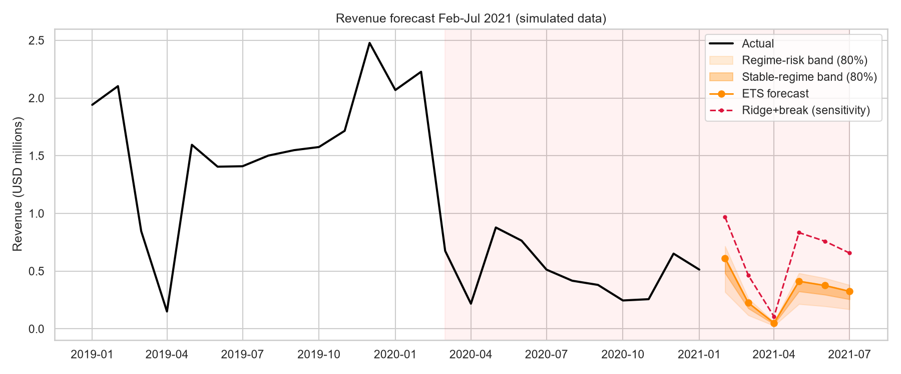
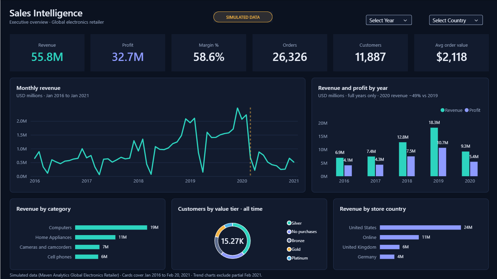
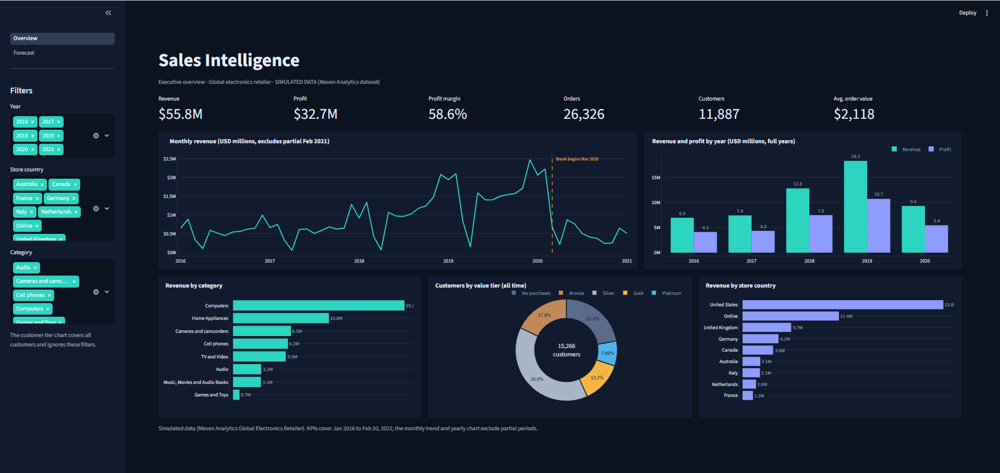

# AI-Powered Sales Intelligence & Forecasting System

An end-to-end sales analytics project: a PostgreSQL star schema, SQL analysis, exploratory data analysis, a backtested monthly revenue forecast, a Power BI dashboard, and a deployed Streamlit app.

> **All data in this project is SIMULATED.** It is the *Global Electronics Retailer* dataset from Maven Analytics, describing a fictitious company. Findings describe this dataset only. They are not observations about any real business.

> **Status:** Complete. Every planned phase is done except the optional LLM layer, which was deliberately skipped (see [Scope decisions](#scope-decisions-and-limitations)).

**Live app:** https://sales-intelligence-forecasting.streamlit.app/ (free hosting: it sleeps when idle, so the first load can take a few seconds)



## What this project found

| | |
|---|---|
| Data | 62,884 order lines, 26,326 orders, 11,887 buying customers (15,266 customers in total), Jan 2016 to 20 Feb 2021 |
| Totals | Revenue $55.76M, profit $32.66M, margin 58.6% (constant, because each product has one price) |
| A structural break in 2020 | Annual revenue fell 49% (about $18.3M in 2019 to $9.3M in 2020), and new customers fell 66.6% |
| Best forecasting model | ETS (damped Holt-Winters on log revenue): **10.3% error** in stable months and **50.3%** in months touching the 2020 break |
| Forecast, Feb to Jul 2021 | About **$2.0M** in total, roughly a quarter of the same months in 2019, with two stated uncertainty bands |
| The honest limit | Only one break and one post-break year exist, so the forecast is conditional on the new level persisting |

Backtest results (rolling-origin, 23 origins, 3 months ahead, 69 forecasts). WAPE is the weighted absolute percentage error, so lower is better:

| Model | Stable months | Months touching the 2020 break |
|---|---|---|
| Seasonal naive | 25.4% | 131.8% |
| **ETS (chosen)** | 10.3% | **50.3%** |
| SARIMA | 19.8% | 57.6% |
| Ridge regression | 12.1% | 152.7% |
| Ridge + break flag | 12.1% | 86.1% |
| ETS + Ridge (average) | **6.5%** | 96.1% |
| ETS + SARIMA (average) | 14.3% | 52.9% |

ETS+Ridge is the most accurate in stable months but fails at the break, and it was picked after seeing the results, so it is not the headline model. Full reasoning is in [`docs/phase5_findings.md`](docs/phase5_findings.md).



## How the pieces fit

```
Maven Analytics CSVs (simulated)
        |  src/load_data.py
        v
PostgreSQL, schema "sales": fact_sales + dim tables + 2 views
        |
        +--> sql/*.sql ................. SQL analysis (joins, CTEs, window functions)
        |
        +--> notebooks/ + src/ ......... EDA and forecasting (backtest framework, models)
        |
        +--> Power BI (Import mode) .... powerbi/sales_dashboard.pbix
        |
        +--> src/export_snapshots.py ... compares totals with SQL, then writes
                    |                     app/snapshots/*.csv.gz
                    v
             Streamlit app (app/) --> Streamlit Community Cloud
```

The app reads snapshot files, not the database, so it runs anywhere. The export script refuses to write the snapshots unless their totals match the database and the figures verified earlier (revenue $55,755,479.59; 26,326 orders; 11,887 customers).

## What was built, phase by phase

| Phase | Deliverable | Where |
|---|---|---|
| 2 | Star schema in PostgreSQL, load and validation scripts | `sql/01`, `sql/02`, `src/load_data.py`, `src/quality_checks.py` |
| 3 | SQL analysis: KPIs, joins, CTEs, segmentation, date trends, window functions | `sql/03` to `sql/11`, [`docs/phase3_findings.md`](docs/phase3_findings.md), [`docs/data_quality_log.md`](docs/data_quality_log.md) |
| 4 | Exploratory data analysis | [`notebooks/01_eda_overview.ipynb`](notebooks/01_eda_overview.ipynb), [`docs/phase4_findings.md`](docs/phase4_findings.md) |
| 5 | Forecasting with a rolling-origin backtest | [`notebooks/02_forecasting.ipynb`](notebooks/02_forecasting.ipynb), `src/backtest.py`, `src/forecasters.py`, [`docs/phase5_findings.md`](docs/phase5_findings.md) |
| 6 | Power BI dashboard | `powerbi/` |
| 7 | LLM explanation layer | Skipped on purpose |
| 8 | Streamlit app, deployed | `app/` |

## Forecasting method in brief

- **Series:** monthly revenue, Jan 2016 to Jan 2021 (61 months). Feb 2021 is partial and excluded.
- **Transform:** log, because seasonal swings grow with the level.
- **Evaluation:** an expanding-window backtest, with results split into stable and break regimes so one pooled number cannot hide the 2020 collapse.
- **Models:** seasonal naive, ETS, SARIMA, ridge regression (trend and month effects), ridge with a post-break flag, and two averages.
- **Uncertainty:** bands built from the model's own backtest errors. A stable-regime band covered only 18% of outcomes around the break, and a regime-risk band covered 61%. Neither is a guarantee.
- **Checks:** a leakage test, fallback logging for every model fit, and an assertion that no model silently fell back to the baseline.

## Power BI dashboard



*Executive overview built in Power BI Desktop. All data is simulated.*

The report is `powerbi/sales_dashboard.pbix`. It reads the star schema in the PostgreSQL `sales` schema and uses the theme in `powerbi/sales_intelligence_dark.json`.

**What it shows:** revenue, profit, margin, orders, customers and average order value; monthly revenue with the 2020 break marked; revenue and profit by year; revenue by category and by store country; and customers by value tier. The Year and Country slicers filter the page, and clicking a bar cross-filters the other visuals.

**Verified:** the dashboard totals reconcile to SQL (revenue $55,755,479.59, 26,326 orders, 11,887 customers), and the 2020 figures match too (4,635 orders, 3,868 customers).

**To open it:** install Power BI Desktop (Windows only) and open the file. The data is stored inside it (Import mode), so it displays without a database. To refresh it, the local PostgreSQL database must be running, and you enter your own credentials in Power BI. Credentials are not stored in this repository.

## Streamlit app



**Overview page:** six KPIs, monthly revenue with the 2020 break marked, revenue and profit by year, revenue by category and by store country, and customers by value tier. Filters for year, store country and category are in the sidebar.

**Forecast page:** actual revenue plus the Feb to Jul 2021 ETS forecast, with two uncertainty bands, the Ridge+break scenario, a forecast table, the model scoreboard, and the limitations.

### Run it locally (no database needed)

Needs Python 3.11 or newer.

```powershell
pip install -r app/requirements.txt
streamlit run app/streamlit_app.py
```

The app opens at `http://localhost:8501`.

### Regenerate the snapshots (needs the database)

```powershell
python src/export_snapshots.py
```

The forecast table (`app/snapshots/forecast_feb_jul_2021.csv`) comes from `notebooks/02_forecasting.ipynb`. The scoreboard (`app/snapshots/model_scoreboard.csv`) holds the backtest results documented in `docs/phase5_findings.md`.

## Reproduce everything from scratch

These commands are for Windows PowerShell.

1. Clone the repository and open the folder.
2. Create and activate a virtual environment:
   ```powershell
   python -m venv .venv
   .venv\Scripts\Activate.ps1
   ```
3. Install dependencies: `pip install -r requirements.txt`
4. Install PostgreSQL and create a database named `sales_intelligence`.
5. Create a `.env` file in the project root. It is git-ignored and must never be committed:
   ```
   DB_HOST=localhost
   DB_PORT=5432
   DB_NAME=sales_intelligence
   DB_USER=postgres
   DB_PASSWORD=your-password
   ```
   Use your own port if 5432 is taken. The author's installation used 5433.
6. Verify the connection: `python src/test_connection.py`
7. Download the dataset from [Maven Analytics](https://mavenanalytics.io/data-playground/global-electronics-retailer) and place the CSV files in `data/raw/`.
8. Create the schema: `psql -U postgres -d sales_intelligence -f sql/01_create_schema.sql`
9. Load the data: `python src/load_data.py`
10. Validate the load: `psql -U postgres -d sales_intelligence -f sql/02_validate_load.sql`
11. Run the SQL files in `sql/` in numeric order, then open the notebooks in `notebooks/`.

## Data

**Source and licence:** the *Global Electronics Retailer* dataset from the [Maven Analytics Data Playground](https://mavenanalytics.io/data-playground/global-electronics-retailer). The dataset page lists Microsoft as the source and the licence as Public Domain (checked November 2026). The raw CSVs are not stored in this repository. The repository does include derived snapshot files at order-line level (`app/snapshots/`), which hold customer keys but no names or contact details.

| Table | Rows | Description |
|---|---|---|
| `fact_sales` | 62,884 | Order lines, Jan 2016 to 20 Feb 2021 |
| `dim_customers` | 15,266 | Customers in 8 countries |
| `dim_products` | 2,517 | Products with unit cost and price |
| `dim_stores` | 67 | Physical stores plus the online store (key 0) |
| `dim_date` | 2,557 | Calendar table |
| `exchange_rates` | 11,215 | Daily rates against USD |

## Scope decisions and limitations

- **The LLM explanation layer was skipped.** It needs a paid API with ongoing cost, and the project is built on free tools. The forecasting is statistical and machine learning, with no language model in it.
- **No discount data exists,** so discount analysis is out of scope.
- **Each product has one price,** so revenue changes come only from quantity and product mix.
- **The simulated margin (about 59%) is far above real retail levels.**
- **February 2021 is a partial month** and is excluded from the monthly series.
- **About 10% of days each year (a fixed spring window) have no orders,** so March and April totals are understated.
- **One structural break and one post-break year.** Conclusions about break behaviour rest on about six informative months.
- **Single monthly total.** No product, store or country forecasts, and no outside drivers.
- **Free hosting:** the live app sleeps when idle.

See [`docs/data_quality_log.md`](docs/data_quality_log.md) for the data profiling results.

## What I would do next

1. Add automated tests and a continuous-integration run.
2. Forecast by category or country, and reconcile the pieces to the total.
3. Re-test break-aware models once more post-break data exists.
4. Refresh the snapshots on a schedule.
5. Add a language-model layer that explains the verified numbers, if a budget allows.

## Tech stack

| Area | Tools |
|---|---|
| Database | PostgreSQL 18, SQL |
| Analysis | Python 3.13, pandas, NumPy, Matplotlib, Seaborn, Plotly |
| Forecasting | statsmodels, scikit-learn |
| BI | Microsoft Power BI Desktop |
| App | Streamlit, deployed on Streamlit Community Cloud |
| Version control | Git, GitHub |

## Project structure

```
app/         Streamlit app (streamlit_app.py, overview.py, forecast.py) and data snapshots
data/        Raw and processed data (not tracked in Git)
docs/        Findings for each phase and the data quality log
notebooks/   EDA and forecasting notebooks
powerbi/     Power BI report and theme
reports/     Saved figures and the forecast table
sql/         Schema and analysis queries
src/         Reusable Python modules (loading, backtest, forecasters, snapshot export)
```