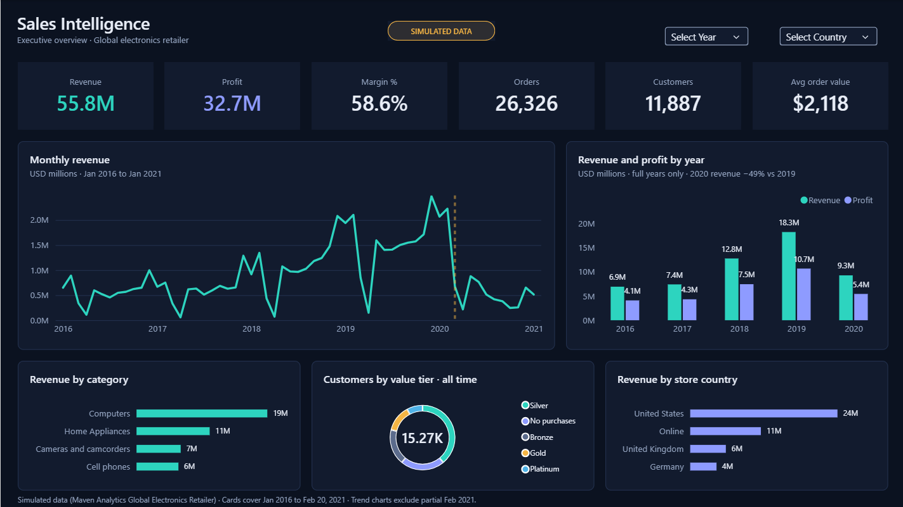
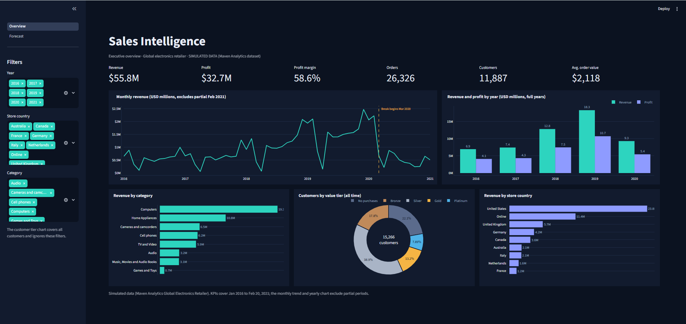
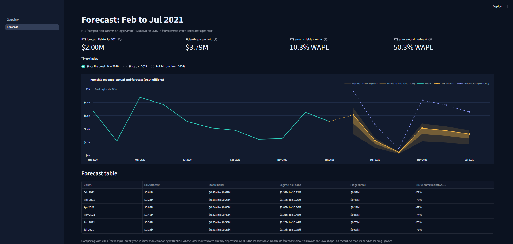

# AI-Powered Sales Intelligence & Forecasting System

An end-to-end sales analytics platform that answers five business questions: what happened, why it happened, what will happen, what the business should do, and how confident the forecasts are.

> **Status:**Phase 6 complete (Power BI dashboard).

## Planned Features

- Relational sales database in PostgreSQL with SQL-based analysis
- Exploratory data analysis with Python (Pandas, NumPy, Seaborn, Plotly)
- Sales forecasting with statistical and machine learning models, evaluated with MAE, RMSE and MAPE
- Interactive Power BI dashboard
- AI-generated business explanations grounded in verified calculations
- Streamlit web application

## Tech Stack

| Area | Tools |
|---|---|
| Database | PostgreSQL 18, SQL |
| Analysis | Python 3.13, Pandas, NumPy, Matplotlib, Seaborn, Plotly |
| Forecasting | Scikit-learn, Statsmodels |
| BI | Microsoft Power BI |
| App | Streamlit |

## Project Structure

```
app/         Streamlit application
data/        Raw and processed data (not tracked in Git)
docs/        Documentation and diagrams
notebooks/   EDA and forecasting notebooks
reports/     Saved figures and reports
sql/         Schema and analysis queries
src/         Reusable Python modules
tests/       Validation tests
```

## Setup

1. Clone the repository and open the folder.
2. Create and activate a virtual environment:
   ```
   python -m venv .venv
   .venv\Scripts\Activate.ps1
   ```
3. Install dependencies: `pip install -r requirements.txt`
4. Create a `.env` file in the project root:
   ```
   DB_HOST=localhost
   DB_PORT=5432
   DB_NAME=sales_intelligence
   DB_USER=postgres
   DB_PASSWORD=your-password
   ```
5. Verify the connection: `python src/test_connection.py`

## Data

**All data in this project is SIMULATED.** It is the *Global Electronics Retailer* dataset published by [Maven Analytics](https://mavenanalytics.io/data-playground/global-electronics-retailer) for a fictitious company. Findings describe this dataset only and are not real-world business observations.

| Table | Rows | Description |
|---|---|---|
| `fact_sales` | 62,884 | Order lines, Jan 2016 to 20 Feb 2021 |
| `dim_customers` | 15,266 | Customers in 8 countries |
| `dim_products` | 2,517 | Products with unit cost and price |
| `dim_stores` | 67 | Physical stores plus the online store (key 0) |
| `dim_date` | 2,557 | Calendar table |
| `exchange_rates` | 11,215 | Daily rates against USD |

The raw CSVs are not stored in this repository. To reproduce the database:

1. Download the dataset from Maven Analytics and place the CSVs in `data/raw/`.
2. Create the schema: `psql -U postgres -d sales_intelligence -f sql/01_create_schema.sql`
3. Load the data: `python src/load_data.py`
4. Validate: `psql -U postgres -d sales_intelligence -f sql/02_validate_load.sql`

### Known limitations

- No discount data exists, so discount analysis is out of scope.
- Each product has a single price, so revenue changes come only from quantity and product mix.
- The simulated margin (about 59%) is far above real retail levels.
- February 2021 is a partial month and is excluded from forecasting.
- About 10% of days each year (a fixed spring window) have no orders, so March and April totals are understated.

See `docs/data_quality_log.md` for the data profiling results.

## Power BI dashboard



*Executive overview built in Power BI Desktop. All data is simulated.*

The report is `powerbi/sales_dashboard.pbix`. It reads the star schema in the PostgreSQL `sales` schema and uses the theme in `powerbi/sales_intelligence_dark.json`.

**What it shows:** revenue, profit, margin, orders, customers and average order value; monthly revenue with the 2020 break marked; revenue and profit by year; revenue by category and by store country; and customers by value tier. The Year and Country slicers filter the page, and clicking a bar cross-filters the other visuals.

**Verified:** the dashboard totals reconcile to SQL (revenue $55,755,479.59, 26,326 orders, 11,887 customers), and the 2020 figures match too (4,635 orders, 3,868 customers).

### How to open it

1. Install Power BI Desktop (Windows only).
2. Open `powerbi/sales_dashboard.pbix`. The data is stored inside the file (Import mode), so the report displays without a database.
3. To refresh it, the local PostgreSQL database `sales_intelligence` must be running on `localhost:5433`, loaded with `src/load_data.py`. In Power BI choose Home > Refresh and enter your own database credentials when prompted. Credentials are not stored in this repository.

## Streamlit app





*Two-page interactive app. All data is simulated.*

**Overview page:** six KPIs, monthly revenue with the 2020 break marked, revenue and profit by year, revenue by category and by store country, and customers by value tier. Filters for year, store country and category are in the sidebar.

**Forecast page:** actual revenue plus the Feb to Jul 2021 ETS forecast, with two uncertainty bands (stable-regime and regime-risk), the Ridge+break scenario, a forecast table, the model backtest scoreboard, and the limitations.

### Run it locally

```powershell
pip install streamlit pandas plotly
streamlit run app/streamlit_app.py
```

The app opens at `http://localhost:8501`. It needs no database: it reads small snapshot files in `app/snapshots/`.

### How the snapshots are made

`src/export_snapshots.py` reads PostgreSQL and writes `sales_lines.csv.gz` (one row per order line) and `customer_segments.csv.gz`. Before writing, it compares the snapshot totals with an independent database query and with the figures verified earlier (revenue $55,755,479.59; 26,326 orders; 11,887 customers), and it stops if anything differs. To regenerate the files you need the local PostgreSQL database with the data loaded (`src/load_data.py`):

```powershell
python src/export_snapshots.py
```

The forecast table (`forecast_feb_jul_2021.csv`) comes from `notebooks/02_forecasting.ipynb`. The scoreboard (`model_scoreboard.csv`) holds the backtest results documented in `docs/phase5_findings.md`.